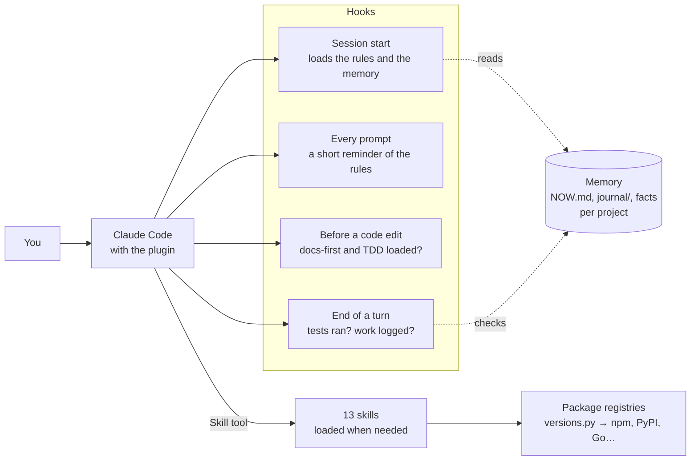
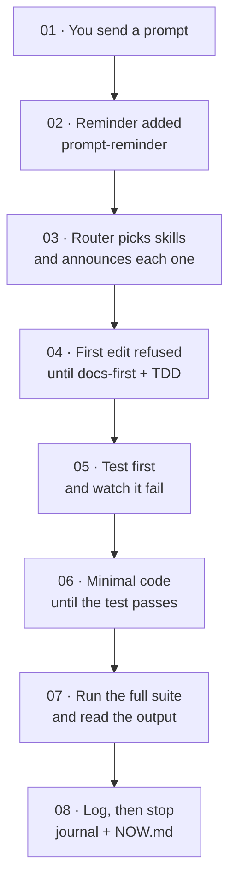
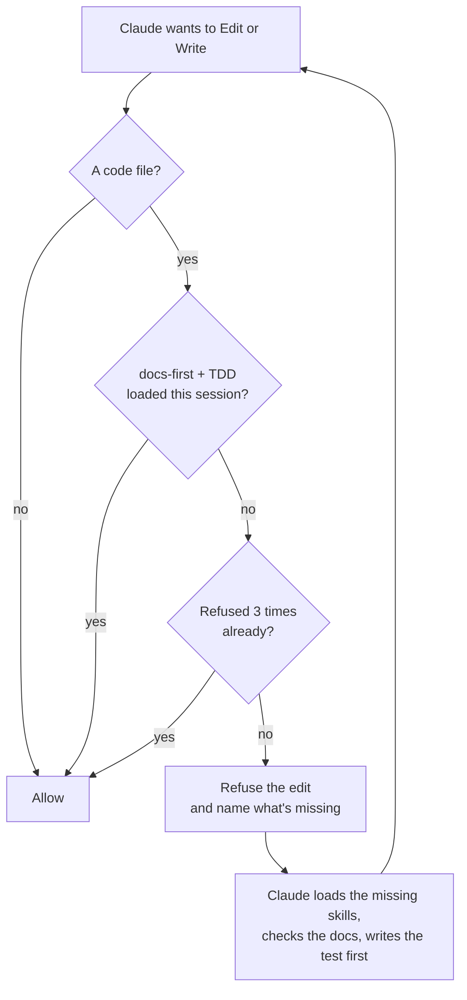
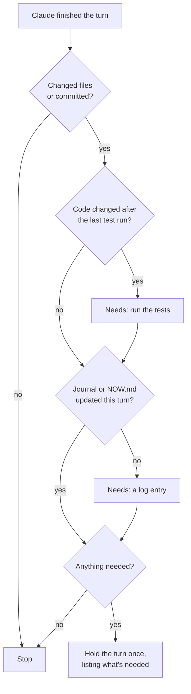

# Wolfin Senior: senior engineering discipline for Claude Code

AI coding agents write code fast. They also guess, forget what was decided an hour ago, and trust what they remember about libraries that have changed since. Wolfin Senior is a free plugin for Claude Code that gives the agent the habits of a senior engineer, and then makes sure it keeps them.

**Built from real experience.** These skills are the result of a Bachelor's degree in Computer Science, a Master's degree in Artificial Intelligence, more than six years of work with the banking sector and payment companies, and training more than 240 students around the world. They write down what that work teaches: understand the problem before building, read the documentation for the version you actually run, write the test first, prove every claim, and leave a record the next person can trust.

```bash
claude plugin marketplace add wolfinApp/wolfin-senior
claude plugin install wolfin-senior@wolfin-senior-marketplace
```

## What you get

Thirteen skills, one for each part of the software development life cycle. Claude loads a skill only when the task needs it, so they cost almost nothing until they're used.

| Phase | Skills |
|---|---|
| Requirements and design | `requirements-and-design`, `engineering-principles` |
| Development | `docs-first`, `writing-plans`, `executing-plans`, `test-driven-development` |
| Testing | `systematic-debugging`, `verification-before-completion`, `code-review-workflow` |
| Deployment | `finishing-and-shipping` |
| Maintenance | `performance-optimization`, `engineering-principles` |
| Every phase | `using-wolfin-senior` (the router), `project-memory` |

Behind them sit the rules that experience keeps proving: fix root causes, not symptoms; every line of code is a liability; estimates are not promises; ship early and iterate; and ask for help after three failed fixes instead of trying a fourth.

## Followed literally, not suggested

A skill is only useful if the agent actually follows it. Wolfin Senior treats its skills as binding: every skill that applies is loaded, announced and followed step by step, and only you can waive a step. Four hooks enforce the parts that matter most, so nothing depends on the agent remembering:

- **Session start:** loads the rules and the project's memory, again after every context compaction.
- **Every message:** a short reminder of the rules, so they stay in view in long sessions.
- **Before every code edit:** the edit is refused until the `docs-first` and `test-driven-development` skills are loaded.
- **End of every turn:** if code changed after the last test run, the agent has to run the tests. If anything changed, it has to log the work.

## Docs first, on the latest release

Before writing code against a library, the agent checks which version the project actually uses and what the latest release is, then reads the official documentation and changelog for exactly the APIs it is about to touch. A bundled script compares installed and latest versions across npm, PyPI, Go, crates.io, RubyGems, Packagist and pub.dev, flags anything a major version behind or past end of life, and links each library's documentation. In an existing project it codes against the installed version and recommends upgrades as separate work. In a new project it starts on the latest stable release.

## Memory that lasts

Context gets compacted and sessions end, but files stay. Each project gets a small memory folder: `NOW.md` says where the work stands, a daily journal records every step and how it was verified, and short topic files keep decisions, preferences and lessons learned. The next session starts from there instead of from zero. Passwords, tokens and keys are never stored, only where they live, and the folder is kept out of git commits.

## A 31-point performance audit

Ask it why an app is slow, and it inspects the code first, then measures on a fast machine and on a slow device over a weak network. It reports the status, priority and expected impact of 31 techniques, from WebP images and code splitting to N+1 queries, indexes, connection pooling and caching. It applies only the ones that fit, one at a time, with numbers before and after. Anything that adds cost, like Redis or a CDN, waits for your approval.

## Install

You need Claude Code and Python 3. The hooks run on macOS and Linux. On Windows, use WSL.

Install it from GitHub:

```bash
claude plugin marketplace add wolfinApp/wolfin-senior
claude plugin install wolfin-senior@wolfin-senior-marketplace
```

Try it for one session, without installing anything:

```bash
claude --plugin-url https://wolfin.app/downloads/wolfin-senior.zip
```

Open a new session and ask it, "What's the project memory path?" If it answers with a `.wolfin-senior/memory` path, the plugin is running. Skills appear as `wolfin-senior:<skill>`. Update later with `claude plugin marketplace update wolfin-senior-marketplace`.

## Tested in real sessions

In a real Claude Code session asked to "add a slugify function with tests", the agent loaded the `test-driven-development` skill on its own. Its first attempt to write a file was refused until it loaded `docs-first` and checked the Node version. It then wrote the test first, watched it fail, wrote the function, ran the tests (8 of 8 passing), and logged the work before finishing.

## Turn a check off

Each guarantee can be switched off on its own with an environment variable set to `off`: `WOLFIN_CODE_GATE`, `WOLFIN_VERIFY_GATE`, `WOLFIN_MEMORY_GATE` and `WOLFIN_REMINDER`.

## How it works

Installing Wolfin Senior adds four kinds of parts to Claude Code: skills that hold the know-how, hooks that enforce it, two scripts that gather facts, and a memory folder that outlives every session. This guide walks through what runs, when it runs, and how each rule gets enforced, so you know exactly what the agent is doing on your behalf.

| Part | How many | What it does |
|---|---|---|
| Skills | 13 | Step-by-step instructions Claude loads only when a task needs them: design, docs, planning, tests, debugging, review, performance, shipping, memory |
| Hooks | 4 | Small programs Claude Code itself runs at fixed moments: session start, every message, before a code edit, end of a turn |
| Scripts | 2 | `versions.py` compares installed and latest versions. `inventory.py` gathers performance evidence |
| Memory | 1 folder | `.wolfin-senior/memory/` in each project: where the work stands, what was done, what was decided |

### The big picture



Skills are the expertise. They cost almost nothing until a task needs one, because Claude reads only their one-line descriptions up front. Hooks are the guarantee. Claude Code runs them itself, so they work even when the agent forgets. Memory is plain files on disk, so it survives compaction and new sessions.

### One turn, start to finish

Here is what happens when you ask for a change, for example "add a slugify function with tests":



Steps 4 and 8 are where the hooks step in. If Claude tries to write code before it has checked the docs and loaded the test-first skill, the edit is refused and the refusal names what's missing. If the turn changed code after the last test run, or changed anything without a log entry, the end of the turn is held once until that's done. If the conversation is compacted midway, the session-start hook runs again and puts the rules and the memory back.

### The router

The first skill, `using-wolfin-senior`, is loaded into every session. Its only job is to pick the right skill before Claude responds, and its rules are binding:

- Check the skill map before acting. If there's even a small chance a skill applies, load it.
- Announce it in one line: `Using <skill> to <purpose>.`
- Follow every step, in order, as written. No skipping, merging or "adapting".
- Only you can waive a step, explicitly. The agent's sense that a step is unnecessary doesn't count.
- If a step can't be done, say so and say what was done instead. Never skip silently.
- Load the skill again every time, instead of working from memory of it.

| You say | It starts with | Then |
|---|---|---|
| "Build X", "add a feature" | `requirements-and-design` | `writing-plans`, `executing-plans`, `docs-first`, `test-driven-development` |
| "It's broken", "this test fails" | `systematic-debugging` | `docs-first`, `test-driven-development` for the fix |
| "It's slow", "optimize" | `performance-optimization` | `verification-before-completion` with numbers |
| "Review this", "I got feedback" | `code-review-workflow` | fixes one item at a time |
| "Where were we?", "continue" | `project-memory` | picks up from `NOW.md` |
| "Commit", "open a PR", "deploy" | `finishing-and-shipping` | verification first, then the release checklist |

Process skills come first because they set the direction. A design question is settled before any code, and a bug's root cause is found before any fix.

### The four hooks

| Hook | Runs | What it enforces |
|---|---|---|
| `session-start` | New session, resume, clear, after compaction | Loads the router as binding instructions, plus `NOW.md`, the memory index and the latest journal entries |
| `prompt-reminder` | Every message you send | About 100 tokens restating the rules, so they stay in view in long sessions |
| `code-gate.py` | Before every edit of a code file | Refused until `docs-first` and `test-driven-development` are loaded in the session |
| `stop-gate.py` | When Claude finishes a turn | Code changed after the last test run: run the tests. Anything changed: log it |

Before a code edit (`code-gate.py`):



At the end of a turn (`stop-gate.py`):



Both gates have a way out, so they can never trap a session. The code gate stops refusing after three refusals, for example when a helper agent can't load skills. The end-of-turn gate holds a turn at most once. In the real test, the agent's first attempt to write a test file was refused because `docs-first` wasn't loaded yet. It loaded it, checked the Node version, and the next attempt went through.

### The memory folder

```
<project>/.wolfin-senior/memory/
├── NOW.md                where the work stands, rewritten to stay true
├── MEMORY.md             index: one line per saved fact
├── journal/
│   └── 2026-11-07.md     today's step log, append-only
└── orders-use-keyset-pagination.md   one durable fact
```

A journal entry is short and factual: what was asked, what was done (files), how it was verified (the command and its real output), what was decided and why, and the next step. `NOW.md` is the resume point a fresh session reads first. Facts are saved by type: your preferences, your corrections, decisions, project conventions, lessons from bugs, where things live, and deadlines.

Never saved: passwords, tokens or keys (only where they're kept), anything the code or git history already records, and guesses. In git projects the folder is added to `.git/info/exclude` automatically, so it never ends up in a commit. Preferences that apply to every project live in `~/.claude/wolfin-senior/memory/`.

### The two scripts

```bash
python3 skills/docs-first/scripts/versions.py .
python3 skills/performance-optimization/scripts/inventory.py .
```

**versions.py** reads the project's manifests and lockfiles (npm, PyPI, Go, Cargo, RubyGems, Composer, pub), asks the public registries for the latest stable versions, and prints a table: declared, installed, latest, how far behind, and a documentation link. It also flags runtimes that are past end of life. Package names are sent to the public registries, so use `--only` for private projects.

**inventory.py** lists the frameworks, image and font sizes, build-output sizes, possibly unused dependencies, and code signals for each of the 31 performance techniques. Its output is a list of leads, not verdicts. The agent still reads the files before deciding anything.

### Example: "the app is slow"

- **Pick:** the router loads `performance-optimization`.
- **Inspect:** it runs `inventory.py` and reads the slow screen's code, the data layer and the server setup.
- **Measure first:** on a fast machine, and on a slow device over Slow 4G, plus API latency and queries per request.
- **Report:** all 31 techniques, each marked applied, needs work, missing, not applicable or unknown, with priority and expected impact.
- **Improve:** the fitting ones, one at a time, re-measuring after each and reverting any change that doesn't show a real gain.
- **Ask:** anything that adds cost, like Redis, a CDN or a schema change, waits for your approval.
- **Record:** every measurement and decision goes into the journal, so the next session doesn't start over.

### Settings

Strict mode is the default. Each check can be turned off on its own by setting the variable to `off`:

| Variable | Turns off |
|---|---|
| `WOLFIN_CODE_GATE` | Refusing code edits before `docs-first` and TDD |
| `WOLFIN_VERIFY_GATE` | Asking for a test run after code changes |
| `WOLFIN_MEMORY_GATE` | Asking for a journal entry |
| `WOLFIN_REMINDER` | The reminder on every message |

### When something looks off

| You see | Why | What to do |
|---|---|---|
| No mention of memory at the start | Installed as plain skills, not as a plugin, or an old session | Install it as a plugin and open a new session |
| A code edit gets refused | `docs-first` or `test-driven-development` isn't loaded yet | Expected. Claude loads them and retries |
| It keeps working briefly after answering | The end-of-turn check asked for tests or a log entry | Expected, at most once per turn |
| "lookup failed" in versions.py | No internet, or a private package | Use `--offline`, or `--only` for public packages |

## Files in this repository
```
.claude-plugin/          plugin.json + marketplace.json
hooks/hooks.json         when each hook runs
hooks/session-start      injects the binding router and memory
hooks/prompt-reminder    short reminder on every message
hooks/code-gate.py       code edits need docs-first and TDD loaded
hooks/stop-gate.py       end of turn: tested after the last edit, work logged
skills/<name>/SKILL.md   the skill itself
skills/<name>/references/   references read only when needed
skills/docs-first/scripts/versions.py
skills/performance-optimization/scripts/inventory.py
```

## Credits and license

MIT. Parts of the workflow skills (planning, test-driven development, debugging, review) are adapted from the open-source [superpowers](https://github.com/obra/superpowers) project by Jesse Vincent, under the MIT License. See [LICENSE](LICENSE).

Articles: [wolfin.app](https://wolfin.app/blog?post=wolfin-senior-plugin)
