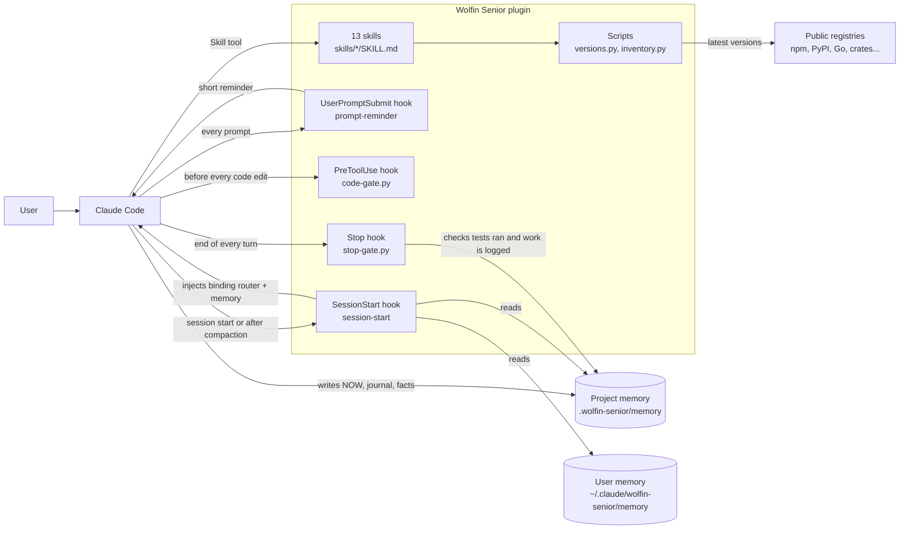
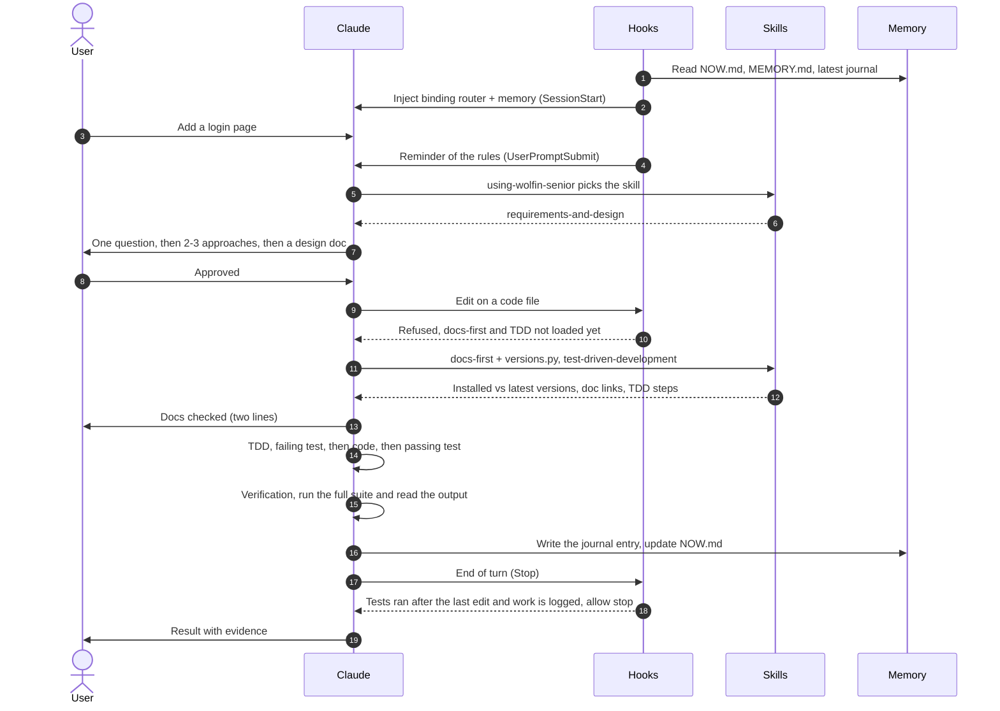
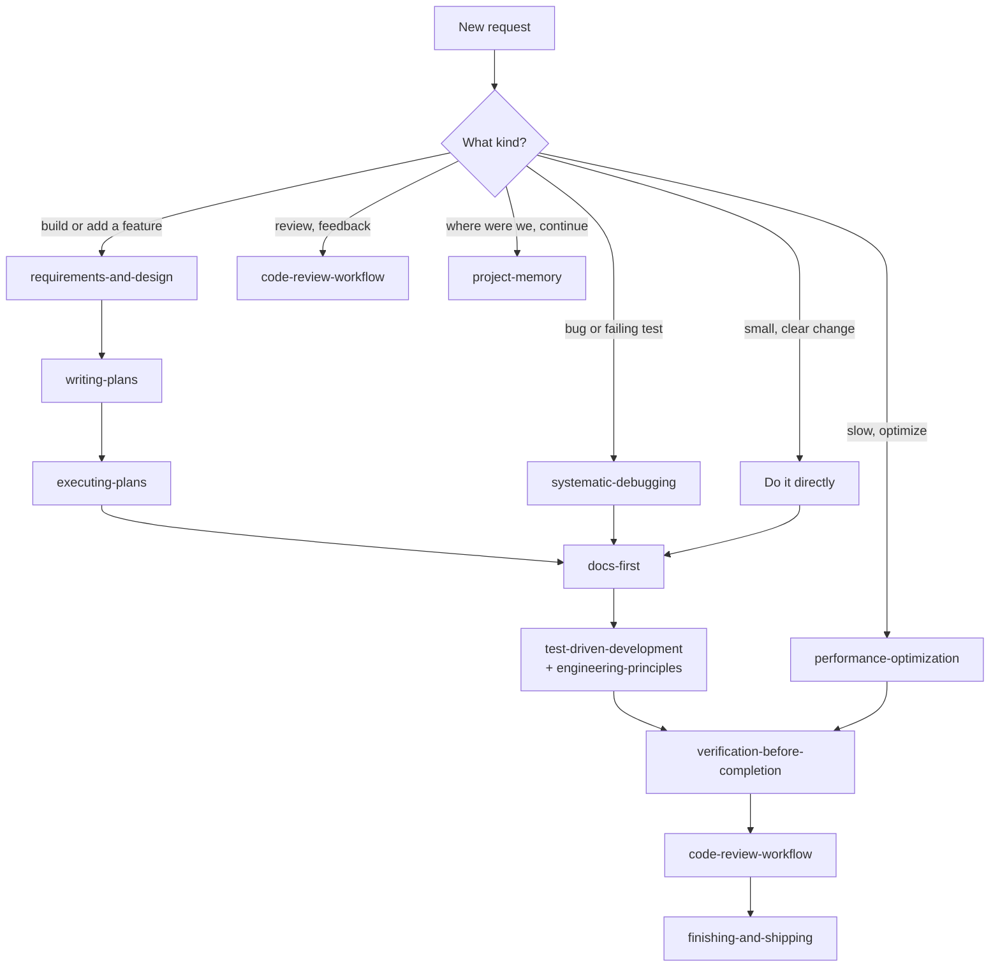
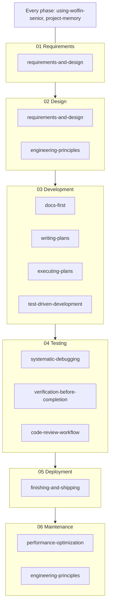
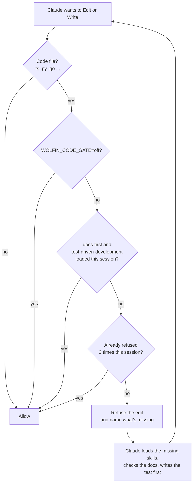
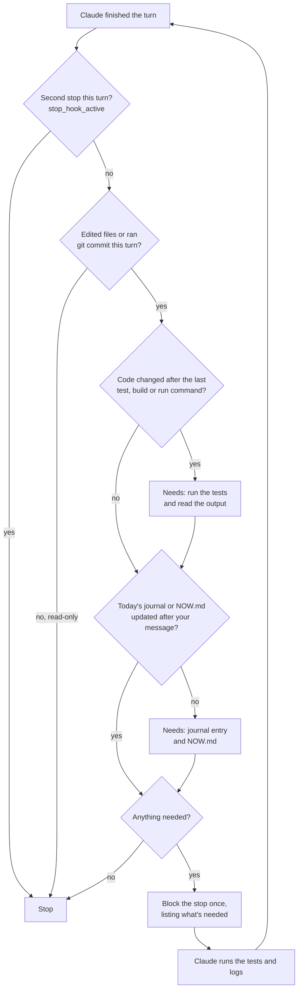
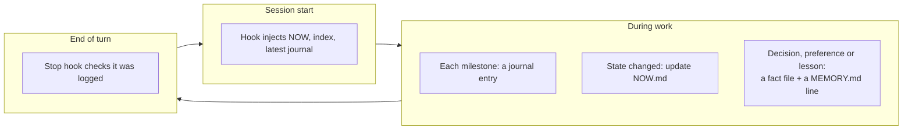

# How Wolfin Senior works

[العربية](how-it-works.md) · **English**

Plugin id: `wolfin-senior` (plugin names can't contain spaces). Skills appear as `wolfin-senior:<skill>`.

A complete guide to the plugin: what's in it, how the parts work together,
and exactly what happens from the moment a session opens until it ends.

---

## The idea in two lines

Without guidance, Claude writes good code, but it can guess, forget, or rely
on outdated knowledge of libraries. Wolfin Senior gives it **senior-engineer
habits** (skills), **automatic guarantees** (hooks) that it follows them, and
**memory** that survives across sessions.

**Strict mode:** the skills are binding, not suggestions. Every loaded skill
is followed step by step, and only the user can waive a step. The hooks
enforce the most important rules mechanically.

| Part | Count | What it does |
|---|---|---|
| **Skills** | 13 | Instructions Claude loads when it needs them: how to design, test, debug, review, optimize, ship |
| **Hooks** | 4 | Scripts Claude Code runs automatically at set moments: session start, every prompt, before a code edit, end of each turn |
| **Scripts** | 2 | Inspection tools: `versions.py` (installed vs latest versions) and `inventory.py` (performance audit) |
| **Memory** | folder | `.wolfin-senior/memory/` in each project, and `~/.claude/wolfin-senior/memory/` for global preferences |

---

## 1. The big picture



**In short:**
- **Skills are the expertise.** Claude loads a skill only when it's needed, so they don't bloat the context.
- **Hooks are the guarantee.** They don't depend on Claude remembering anything, because Claude Code runs them itself.
- **Memory is files on disk.** Context gets compacted and sessions end, but files stay.

---

## 2. What happens in a full session

Example: you say "add a login page".



If the conversation gets compacted midway, the start hook runs again and
re-injects NOW.md and the journal, so work resumes from the same point.

---

## 3. The router: how a skill gets picked

The first skill, `using-wolfin-senior`, is injected at the start of every
session. It has one job: **before responding to any programming task, check
which skill applies and load it.** Process skills (design, debugging) come
first because they set the direction. Implementation skills follow.

Its rules are binding:
1. Check the map before acting. If there's even a small chance a skill applies, load it.
2. Announce it: "Using <skill> to <purpose>."
3. Follow every step, in order, as written. No skipping, merging or "adapting".
4. Only the user can waive a step, explicitly.
5. If a step can't be done, say so and say what was done instead.
6. Re-load the skill every time. Don't work from memory of it.



---

## 4. Skills by SDLC phase



After maintenance, a new cycle starts again at requirements (06 → 01).

| Skill | Fires when... | Its key rule |
|---|---|---|
| `using-wolfin-senior` | At the start of any task | Pick the skill before responding, and apply the 19 rules as behaviors |
| `requirements-and-design` | "build", "add", "design" | No code before you approve the design |
| `docs-first` | Before any code that uses a library or framework | No code against an API it hasn't checked for the installed version |
| `writing-plans` | Approved design, multi-step work | Every task is small, with a test, a command and the expected output |
| `executing-plans` | "execute the plan" | A progress ledger that survives compaction, and a review at the end |
| `test-driven-development` | Any code or fix | Test first, and watch it fail |
| `engineering-principles` | Writing or refactoring code | The 10 principles: SOLID, security, robustness... |
| `systematic-debugging` | A bug or odd behavior | No fix before the root cause. After 3 failed fixes, stop and rethink |
| `verification-before-completion` | Before saying "done" | Evidence before claims |
| `code-review-workflow` | A finished task, or incoming feedback | Verify before implementing. No flattery |
| `finishing-and-shipping` | Commit, PR, release | Commit messages that explain why, and a rollback plan |
| `performance-optimization` | "slow", "optimize" | Inspect and measure first, 31 criteria, one change at a time |
| `project-memory` | Always | NOW, journal and facts. Never stores secrets |

---

## 5. The four hooks in detail

### 5.1 Session start: `session-start`

Runs on `startup` (new session), `resume`, `clear`, and `compact` (after the
conversation is compacted).

Injects into the context, wrapped as binding instructions:
1. The full router skill
2. The resolved memory path. In git worktrees it resolves to the main checkout, so every worktree shares one memory
3. `NOW.md` (first 80 lines), `MEMORY.md` (first 150), and the last 40 lines of the latest journal
4. The user memory index (first 60 lines)

It also adds `.wolfin-senior/` to `.git/info/exclude` when the folder exists.

### 5.2 Every prompt: `prompt-reminder`

Adds one short paragraph (about 100 tokens) to every message you send: check
the map, load the skills that apply, follow them step by step, docs-first and
TDD before code, evidence before "done", log milestones. In a long session
the start-of-session injection is far back in the context. This keeps the
rules in view.

### 5.3 Before every code edit: `code-gate.py`



Every code edit is refused until both skills have been loaded in the session
(running `versions.py` also counts for docs-first). The refusal names exactly
what's missing. **Why stop after 3 refusals?** So the gate can never trap a
session, for example a subagent that can't load skills.

### 5.4 End of turn: `stop-gate.py`



Two checks, one block:
- **Verification** (`WOLFIN_VERIFY_GATE`): if a code file changed after the last test, build, lint or run command, it must verify, or say exactly why it can't.
- **Logging** (`WOLFIN_MEMORY_GATE`): if anything changed, the journal and NOW.md must be updated.

It blocks at most once per turn, so it can never loop.

---

## 6. Memory

```
<repo root>/.wolfin-senior/memory/
├── NOW.md                 Where things stand (rewritten to stay true)
├── MEMORY.md              Index: one line per fact
├── journal/
│   ├── 2026-11-04.md      Today's step log (append-only)
│   └── 2026-10-summary.md Summary of an older month
└── orders-use-keyset-pagination.md   A durable fact (decision, preference, lesson...)
```



**Fact types:** `user` (your preferences), `feedback` (your corrections),
`decision` (a choice and its reason), `convention` (a project rule),
`lesson` (learned from a bug), `reference` (where things live), and
`project` (goals and deadlines).

**Never stored:** passwords, tokens or keys (only *where* they live),
anything already recorded in the code or git, and guesses.

**Privacy:** the folder is added to `.git/info/exclude`, so it is never
committed unless you ask.

---

## 7. The scripts

### `versions.py`: installed vs latest

```bash
python3 skills/docs-first/scripts/versions.py /path/to/project
python3 skills/docs-first/scripts/versions.py . --only next,react,django
python3 skills/docs-first/scripts/versions.py . --offline
```

Reads `package.json`, `requirements.txt`, `pyproject.toml`, `go.mod`,
`Cargo.toml`, `Gemfile`, `composer.json` and `pubspec.yaml`, plus lockfiles
and the venv. Prints a table with the declared version, the installed
version, the latest version, a status (✅, minor behind, or ⚠️ major
behind), and the docs link. It also reports the runtimes (Node, Python, Go,
Ruby, PHP) and flags any past end of life.

Package names are sent to public registries. For private packages, use
`--only` to check only the public ones.

### `inventory.py`: performance audit

```bash
python3 skills/performance-optimization/scripts/inventory.py /path/to/project
```

Reports the frameworks, image and font sizes, build-output sizes, possibly
unused dependencies, and code signals for each of the 31 criteria.
**These are leads, not verdicts.** Claude must read the files before deciding.

---

## 8. A real example: "the app is slow"

1. The **router** picks `performance-optimization`.
2. **Inspect:** runs `inventory.py` and reads the important files.
3. **Measure before:** Lighthouse on a fast device, and on a slow device over
   a weak network (Slow 4G), autocannon or k6 for the API, and queries per
   request.
4. **Report:** a table of all 31 criteria (✅ applied, ⚠️ needs improvement,
   ❌ missing, ➖ not applicable, ❓ unknown), with priority and expected impact.
5. **Apply only what fits,** one change at a time:
   - `docs-first` before each change, and TDD to protect behavior
   - measure after each one, and revert it if there's no clear gain
   - one commit per improvement, with the numbers in the message
6. **Ask for your approval** on anything that adds cost: Redis, a CDN, database changes.
7. **Log** every measurement and decision in the journal, so the next session doesn't re-measure.

---

## 9. Settings

Strict mode is the default. Each guarantee can be turned off on its own:

| Variable | Effect |
|---|---|
| `WOLFIN_CODE_GATE=off` | Code edits no longer need docs-first and TDD loaded first |
| `WOLFIN_VERIFY_GATE=off` | The end of a turn no longer asks for a test/build run after code changes |
| `WOLFIN_MEMORY_GATE=off` | The end of a turn no longer asks for a journal entry |
| `WOLFIN_REMINDER=off` | No reminder on every prompt |

```bash
export WOLFIN_MEMORY_GATE=off
```

---

## 10. Installing and running

Try it for one session, without installing:
```bash
claude --plugin-url https://wolfin.app/downloads/wolfin-senior.zip
```

Install it from GitHub:
```bash
claude plugin marketplace add wolfinApp/wolfin-senior
claude plugin install wolfin-senior@wolfin-senior-marketplace
claude plugin list
```

Or from wolfin.app, without GitHub:
```bash
curl -LO https://wolfin.app/downloads/wolfin-senior.zip && unzip -o wolfin-senior.zip -d ~
claude plugin marketplace add ~/wolfin-senior
claude plugin install wolfin-senior@wolfin-senior-marketplace
```

Then open a new session. Hooks only take effect in new sessions.

**Updating after you edit files:** because the marketplace is a local folder,
sessions read the skills directly from that folder (`~/wolfin-senior`), so
an edit takes effect in the next new session. That's what the real test
showed. If a change doesn't show up, bump `version` in
`.claude-plugin/plugin.json` and `.claude-plugin/marketplace.json`, then run:
```bash
claude plugin marketplace update wolfin-senior-marketplace
```
```bash
claude plugin update wolfin-senior@wolfin-senior-marketplace
```

**Pause or remove:**
```bash
claude plugin disable wolfin-senior@wolfin-senior-marketplace
```
```bash
claude plugin uninstall wolfin-senior@wolfin-senior-marketplace
```

**Cost:** per `claude plugin details`, the skill descriptions add about 2.4k
tokens to every session, and each loaded skill costs 1k to 3k. The start
hook adds the router and memory (about 3k tokens, growing with the memory),
and the prompt reminder adds about 100 tokens per message.

**Check that it works:** in a new session, ask "what's the project memory
path?". If it answers with a `.wolfin-senior/memory` path, the start hook is
working.

### Real test (2026-11-05)

We ran a real Claude session (Sonnet) in a scratch project after installing,
with the prompt "add an Express server with GET /health". What happened:

| Step | Result |
|---|---|
| Start hook | ✅ Injected the router and memory, and all 13 skills appeared |
| First Write to `src/server.js` | ✅ Denied: "the docs haven't been checked yet" |
| docs-first | ✅ Loaded the skill and ran `versions.py`: declared `express@^4.19.2`, latest 5.3.0 |
| Report before coding | ✅ "Coding against the declared 4.x API" |
| Writing the code | ✅ Allowed on the second attempt |
| Honesty | ✅ Said it couldn't run the server because express wasn't installed, instead of claiming it works |
| End hook | ✅ Asked it to log, so it wrote `journal/2026-11-05.md` and `NOW.md` |
| Time and cost | 58 seconds, 13 turns, about $0.59 |

The test surfaced one issue, now fixed: `.wolfin-senior/` wasn't being added to
`.git/info/exclude` automatically. The hooks now add it themselves.

### Strict-mode test (2026-11-07)

A second real session (Sonnet), with the plugin loaded for that session only
(`--plugin-dir`), and the prompt "add a slugify function with tests, no
dependencies":

| Step | Result |
|---|---|
| Before any code | ✅ Loaded test-driven-development on its own |
| First Write (the test file) | ✅ Refused: "Missing in this session: docs-first" |
| docs-first | ✅ Loaded it and checked the Node version and `node:test` |
| TDD | ✅ Wrote the test first, watched it fail (module missing), then wrote the function. `npm test` → 8/8 |
| Verification | ✅ Loaded verification-before-completion and re-ran the tests before saying done |
| End of turn | ✅ Asked only for logging, since tests had run after the last code edit. It wrote the journal and NOW.md |
| Prompt reminder | ✅ Reached the model, which quoted it word for word in a separate check |
| git | ✅ `.wolfin-senior/` stays out of commits, and `git status` shows only `src/` |
| Time and cost | 83 seconds, 20 turns, about $0.71 |

---

## 11. Troubleshooting

| Problem | Likely cause | Fix |
|---|---|---|
| Memory isn't mentioned at session start | Installed as personal skills instead of a plugin, or an old session | Install as a plugin and open a new session |
| Code edits get refused | docs-first or test-driven-development isn't loaded yet | Expected: Claude loads them and retries. To turn it off: `WOLFIN_CODE_GATE=off` |
| It keeps working briefly after answering | The end-of-turn check asked it to run the tests or write the journal | Expected, at most once per turn |
| `versions.py` shows "lookup failed" | No internet, or a private package | Use `--offline`, or `--only` for public packages |
| "Python < 3.11" warning | macOS's older Python can't read TOML | Install a newer Python, or ignore it (everything else is still checked) |

---

## 12. File layout

```
DevsSkills/
├── .claude-plugin/
│   ├── plugin.json            Plugin definition
│   └── marketplace.json       Local marketplace for installing it
├── hooks/
│   ├── hooks.json             When each hook runs
│   ├── session-start          Injects the binding router and memory
│   ├── prompt-reminder        Short reminder on every prompt
│   ├── code-gate.py           Code edits need docs-first and TDD loaded
│   └── stop-gate.py           End of turn: tests ran after the last edit, work logged
├── skills/<name>/
│   ├── SKILL.md               The skill itself
│   ├── references/            References read only when needed
│   └── scripts/               Tools (versions.py, inventory.py)
├── docs/
│   ├── how-it-works.md        This guide in Arabic
│   └── how-it-works.en.md     This guide in English
├── README.md                  The README in English
├── README.ar.md               The README in Arabic
└── LICENSE                    MIT, including the superpowers notice
```
