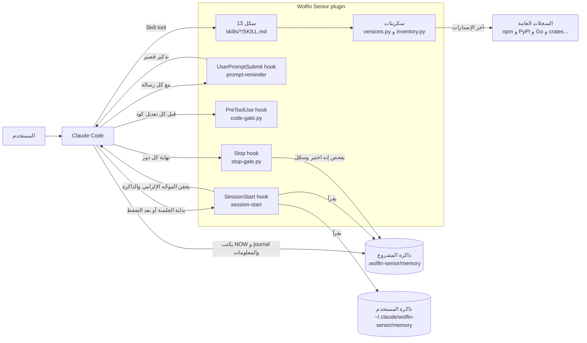
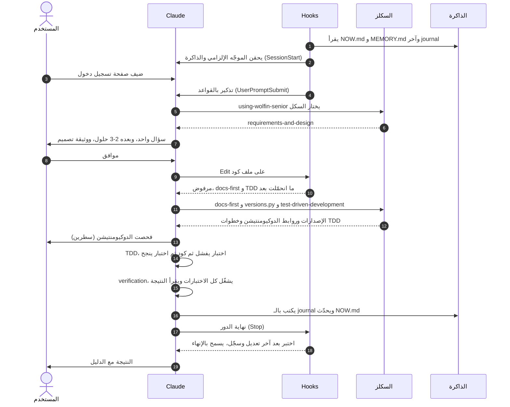
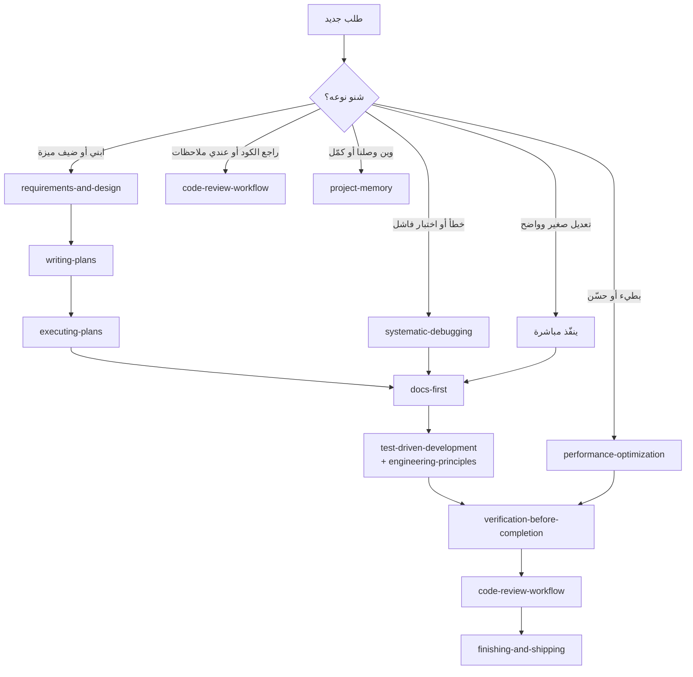
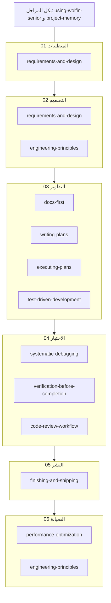
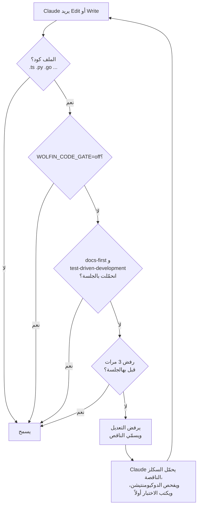
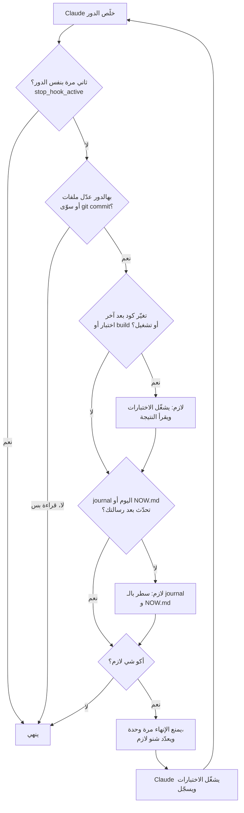
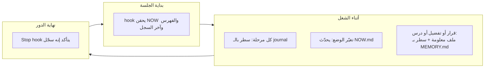

# شلون يشتغل Wolfin Senior

**العربية** · [English](how-it-works.en.md)

الاسم التقني: `wolfin-senior` (أسماء الـ plugins ما تقبل مسافات)، والسكلز تظهر باسم `wolfin-senior:<skill>`.

دليل كامل للـ plugin: شنو بيه، وشلون أجزاءه تشتغل ويا بعض، وشنو يصير بالضبط من تفتح جلسة لحد ما تخلص.

---

## الفكرة بسطرين

Claude بدون توجيه يكتب كود زين، بس ممكن يخمّن، أو ينسى، أو يعتمد على معلومات قديمة عن المكتبات.
Wolfin Senior يعطيه **عادات مهندس كبير** (سكلز)، و**ضمانات تلقائية** (hooks) تتأكد إنه يلتزم بيها، و**ذاكرة** تبقى بين الجلسات.

**الوضع الصارم:** السكلز إلزامية، مو اقتراحات. كل سكل ينحمّل يتطبّق خطوة بخطوة، وماكو أحد يگدر يلغي خطوة إلا المستخدم. والـ hooks تفرض أهم القواعد تلقائياً.

| الجزء | العدد | شنو يسوي |
|---|---|---|
| **السكلز** | 13 | تعليمات يحمّلها Claude لما يحتاجها: كيف يصمم، يختبر، يصلّح، يراجع، يحسّن الأداء، ينشر |
| **الـ hooks** | 4 | سكربتات يشغّلها Claude Code تلقائياً بلحظات معيّنة: ببداية الجلسة، ومع كل رسالة، وقبل كل تعديل كود، وبنهاية كل دور |
| **السكربتات** | 2 | أدوات فحص: `versions.py` (الإصدارات مقابل آخر تحديث) و `inventory.py` (فحص الأداء) |
| **الذاكرة** | مجلد | `.wolfin-senior/memory/` بكل مشروع، و `~/.claude/wolfin-senior/memory/` للتفضيلات العامة |

---

## 1. الصورة الكاملة



**باختصار:**
- **السكلز** هي "الخبرة": Claude يحمّل السكل المناسب بس لما يحتاجه، فما تثقل السياق.
- **الـ hooks** هي "الضمان": ما تعتمد على إنه يتذكر، لأن Claude Code نفسه يشغّلها.
- **الذاكرة** ملفات على القرص. السياق ينضغط والجلسات تنتهي، بس الملفات تبقى.

---

## 2. شنو يصير بجلسة كاملة

مثال: تگله "ضيف صفحة تسجيل دخول".



لو انضغطت المحادثة بالنص (compact)، فـ hook البداية يشتغل مرة ثانية ويرجّع NOW.md والسجل، فيكمّل من نفس النقطة.

---

## 3. الموجّه: كيف يختار السكل

أول سكل، `using-wolfin-senior`، ينحقن ببداية كل جلسة. وظيفته وحدة: **قبل أي رد على مهمة برمجية، يشوف أي سكل ينطبق ويحمّله.**
سكلز العملية (التصميم، التصحيح) تجي أولاً لأنها تحدد الاتجاه، وبعدها سكلز التنفيذ.

قواعده إلزامية:
1. يشوف الخريطة قبل أي شي. إذا أكو ولو احتمال صغير إن سكل ينطبق، يحمّله.
2. يعلن عنه: "Using <skill> to <purpose>".
3. يطبّق كل خطوة بترتيبها مثل ما مكتوبة، بدون تخطي أو دمج أو "تكييف".
4. ماكو أحد يلغي خطوة إلا المستخدم، وبصراحة.
5. إذا خطوة ما تنسوّى، يگول هذا بوضوح ويگول شنو سوّى بدالها.
6. يحمّل السكل كل مرة، وما يشتغل من ذاكرته عنه.



---

## 4. السكلز حسب مراحل SDLC



بعد الصيانة تبدأ دورة جديدة من المتطلبات (06 ← 01).

| السكل | يشتغل لما... | أهم قاعدة بيه |
|---|---|---|
| `using-wolfin-senior` | ببداية أي مهمة | يختار السكل قبل ما يرد، ويطبّق القواعد الـ19 كسلوك |
| `requirements-and-design` | "ابني"، "ضيف"، "صمم" | ما يكتب كود قبل ما توافق على التصميم |
| `docs-first` | قبل أي كود يستخدم مكتبة أو فريم ورك | ما يكتب كود على API ما فحصه للإصدار المنصّب |
| `writing-plans` | عنده تصميم وشغل متعدد الخطوات | كل مهمة صغيرة وبيها اختبار وأمر ونتيجة متوقعة |
| `executing-plans` | "نفّذ الخطة" | سجل تقدّم (ledger) يصمد بعد الضغط، ومراجعة بالنهاية |
| `test-driven-development` | أي كود أو إصلاح | الاختبار أولاً، ويشوفه يفشل |
| `engineering-principles` | كتابة كود أو إعادة هيكلة | المبادئ العشرة: SOLID، الأمان، المتانة... |
| `systematic-debugging` | خطأ أو سلوك غريب | ما يصلّح قبل ما يلگه السبب الجذري، وبعد 3 محاولات فاشلة يوگف |
| `verification-before-completion` | قبل ما يگول "خلص" | الدليل قبل الادعاء |
| `code-review-workflow` | خلص مهمة، أو وصلته ملاحظات | يتحقق قبل ما يطبّق، وبدون مجاملة |
| `finishing-and-shipping` | commit أو PR أو نشر | رسالة commit تشرح السبب، وخطة تراجع |
| `performance-optimization` | "بطيء"، "حسّن الأداء" | يفحص ويقيس أولاً، و31 معيار، وتحسين وحدة وحدة |
| `project-memory` | دائماً | NOW والـ journal والمعلومات، وما يحفظ أسرار |

---

## 5. الـ hooks الأربعة بالتفصيل

### 5.1 بداية الجلسة: `session-start`

يشتغل عند: `startup` (جلسة جديدة)، و`resume` (استئناف)، و`clear`، و`compact` (بعد ضغط المحادثة).

يحقن داخل السياق، كتعليمات إلزامية:
1. سكل الموجّه كامل
2. مسار الذاكرة المحسوب. بالـ worktrees يحسبه من الـ checkout الأساسي، حتى كل النسخ تشترك بذاكرة وحدة
3. `NOW.md` (أول 80 سطر)، و`MEMORY.md` (أول 150)، وآخر 40 سطر من آخر journal
4. فهرس ذاكرة المستخدم (أول 60 سطر)

وإذا مجلد `.wolfin-senior/` موجود، يضيفه لـ `.git/info/exclude`.

### 5.2 مع كل رسالة: `prompt-reminder`

يضيف فقرة قصيرة (حوالي 100 token) لكل رسالة ترسلها: يشوف الخريطة، ويحمّل السكلز المناسبة، ويطبّقها خطوة بخطوة، و docs-first و TDD قبل الكود، والدليل قبل "خلص"، ويسجّل المراحل. بالجلسات الطويلة، الحقن اللي صار ببداية الجلسة يصير بعيد بالسياق، فهذا يخلّي القواعد قدّامه دائماً.

### 5.3 قبل كل تعديل كود: `code-gate.py`



كل تعديل كود ينرفض لحد ما ينحمّل السكلين بالجلسة (وتشغيل `versions.py` ينحسب لـ docs-first). والرفض يسمّي بالضبط شنو الناقص. **ليش يوگف بعد 3 رفضات؟** حتى ما يعلّق الجلسة أبداً، مثلاً لو وكيل فرعي ما يگدر يحمّل سكلز.

### 5.4 نهاية الدور: `stop-gate.py`



فحصين بمنع واحد:
- **التحقق** (`WOLFIN_VERIFY_GATE`): إذا تغيّر ملف كود بعد آخر اختبار أو build أو lint أو تشغيل، لازم يتحقق، أو يگول بالضبط ليش ما يگدر.
- **التسجيل** (`WOLFIN_MEMORY_GATE`): إذا تغيّر أي شي، لازم يتحدّث الـ journal و NOW.md.

يمنع مرة وحدة بس بالدور، فما يدخل بحلقة أبداً.

---

## 6. الذاكرة

```
<جذر المشروع>/.wolfin-senior/memory/
├── NOW.md                 وين وصلنا (ينكتب من جديد حتى يبقى صحيح)
├── MEMORY.md              فهرس: سطر لكل معلومة
├── journal/
│   ├── 2026-11-04.md      سجل اليوم (إضافة بس)
│   └── 2026-10-summary.md ملخص شهر قديم
└── orders-use-keyset-pagination.md   معلومة دائمة (قرار، تفضيل، درس...)
```



**أنواع المعلومات:** `user` (تفضيلاتك)، و`feedback` (تصحيحاتك إله)، و`decision` (قرار وسببه)، و`convention` (قاعدة بالمشروع)، و`lesson` (درس من خطأ)، و`reference` (وين الأشياء)، و`project` (أهداف ومواعيد).

**ما يحفظ:** كلمات السر والتوكنات والمفاتيح (يحفظ بس مكانها)، ولا الأشياء المكتوبة أصلاً بالكود أو بـ git، ولا التخمينات.

**الخصوصية:** المجلد ينضاف لـ `.git/info/exclude`، فما ينرفع للـ repo إلا إذا طلبت.

---

## 7. السكربتات

### `versions.py`: الإصدارات مقابل آخر تحديث

```bash
python3 skills/docs-first/scripts/versions.py /path/to/project
python3 skills/docs-first/scripts/versions.py . --only next,react,django
python3 skills/docs-first/scripts/versions.py . --offline
```

يقرأ: `package.json` و`requirements.txt` و`pyproject.toml` و`go.mod` و`Cargo.toml` و`Gemfile` و`composer.json` و`pubspec.yaml`، مع ملفات القفل والـ venv.
يطلّع جدول بيه: المعلن، والمنصّب، وآخر إصدار، والحالة (✅ أو minor behind أو ⚠️ major behind)، ورابط الدوكيومنتيشن. ويطلّع حالة اللغات نفسها (Node و Python و Go و Ruby و PHP)، ويأشّر إذا انتهى دعمها.

### `inventory.py`: فحص الأداء

```bash
python3 skills/performance-optimization/scripts/inventory.py /path/to/project
```

يطلّع: نوع الإطارات، وأحجام الصور والخطوط، وحجم ملفات الـ build، ومكتبات ممكن ما مستخدمة، وإشارات بالكود لكل معيار من الـ31.
**هذي أدلة مو أحكام.** Claude لازم يقرأ الملفات قبل ما يقرر.

---

## 8. مثال واقعي: "التطبيق بطيء"

1. **الموجّه** يختار `performance-optimization`.
2. **يفحص:** يشغّل `inventory.py` ويقرأ الملفات المهمة.
3. **يقيس قبل:** Lighthouse على جهاز سريع، وعلى جهاز بطيء مع شبكة ضعيفة (Slow 4G)، و autocannon أو k6 للـ API، وعدد الاستعلامات بكل طلب.
4. **يكتب تقرير:** جدول بالـ 31 معيار (✅ مطبق، ⚠️ يحتاج تحسين، ❌ ناقص، ➖ ما ينطبق، ❓ غير معروف)، مع الأولوية والتأثير المتوقع.
5. **يطبّق المناسب بس**، وحدة وحدة:
   - `docs-first` قبل كل تعديل، و TDD حتى يحمي السلوك
   - يقيس بعد كل تحسين، وإذا ماكو فرق واضح يتراجع عنه
   - كل تحسين بـ commit مستقل والأرقام بالرسالة
6. **يطلب موافقتك** على أي شي يضيف كلفة: Redis، CDN، تغيير قاعدة البيانات.
7. **يسجّل** كل قياس وقرار بالـ journal، حتى الجلسة الجاية ما تعيد القياس.

---

## 9. الإعدادات

| المتغيّر | يسوي |
|---|---|
| `WOLFIN_CODE_GATE=off` | تعديل الكود ما يحتاج بعد docs-first و TDD قبله |
| `WOLFIN_VERIFY_GATE=off` | نهاية الدور ما تطلب بعد تشغيل الاختبارات بعد تغيير الكود |
| `WOLFIN_MEMORY_GATE=off` | نهاية الدور ما تطلب بعد التسجيل بالـ journal |
| `WOLFIN_REMINDER=off` | يوگف التذكير اللي ينضاف لكل رسالة |

```bash
export WOLFIN_MEMORY_GATE=off
```

---

## 10. التنصيب والتشغيل

تجربة بجلسة وحدة بدون تنصيب:
```bash
claude --plugin-url https://wolfin.app/downloads/wolfin-senior.zip
```

التنصيب من GitHub:
```bash
claude plugin marketplace add wolfinApp/wolfin-senior
claude plugin install wolfin-senior@wolfin-senior-marketplace
claude plugin list
```

أو من wolfin.app بدون GitHub:
```bash
curl -LO https://wolfin.app/downloads/wolfin-senior.zip && unzip -o wolfin-senior.zip -d ~
claude plugin marketplace add ~/wolfin-senior
claude plugin install wolfin-senior@wolfin-senior-marketplace
```

بعدها افتح جلسة جديدة. الـ hooks تشتغل بس بالجلسات الجديدة.

**تحديث بعد ما تعدّل الملفات:** لأن الـ marketplace مجلد محلي، الجلسات تقرأ السكلز مباشرة من المجلد (`~/wolfin-senior`)، فأي تعديل يوصل بأول جلسة جديدة. هذا اللي شفناه بالاختبار الحقيقي.
إذا تعديل ما ظهر، ارفع رقم `version` بـ `.claude-plugin/plugin.json` و `.claude-plugin/marketplace.json`، وبعدين:
```bash
claude plugin marketplace update wolfin-senior-marketplace
```
```bash
claude plugin update wolfin-senior@wolfin-senior-marketplace
```

**إيقاف مؤقت أو إزالة:**
```bash
claude plugin disable wolfin-senior@wolfin-senior-marketplace
```
```bash
claude plugin uninstall wolfin-senior@wolfin-senior-marketplace
```

**الكلفة:** حسب `claude plugin details`، أوصاف السكلز تضيف حوالي 2.4 ألف token لكل جلسة، وكل سكل ينحمّل ياخذ 1 لـ 3 آلاف. وhook البداية يضيف الموجّه والذاكرة (حوالي 3 آلاف token، وتزيد ويا كبر الذاكرة)، والتذكير يضيف حوالي 100 token لكل رسالة.

**تتأكد إنه شغّال:** بجلسة جديدة اسأله "شنو مسار ذاكرة المشروع؟". إذا جاوبك بمسار `.wolfin-senior/memory`، فـ hook البداية شغّال.

---

### اختبار حقيقي (2026-11-05)

شغّلنا جلسة Claude حقيقية (Sonnet) بمشروع تجريبي بعد التنصيب، وطلبنا "سوّي Express server بيه GET /health". اللي صار:

| الخطوة | النتيجة |
|---|---|
| hook البداية | ✅ حقن الموجّه والذاكرة، والـ 13 سكل ظهرت |
| أول Write على `src/server.js` | ✅ انرفض: "the docs haven't been checked yet" |
| docs-first | ✅ حمّل السكل وشغّل `versions.py`: المعلن `express@^4.19.2`، وآخر إصدار 5.3.0 |
| التقرير قبل الكود | ✅ "Coding against the declared 4.x API" |
| كتابة الكود | ✅ انسمح بالمحاولة الثانية |
| الصدق | ✅ گال إنه ما گدر يشغّل السيرفر لأن express مو منصّب، وما ادّعى إنه يشتغل |
| hook النهاية | ✅ طلب منه يسجّل، فكتب `journal/2026-11-05.md` و `NOW.md` |
| الوقت والكلفة | 58 ثانية، 13 دور، تقريباً 0.59 دولار |

من هالاختبار طلعت ملاحظة وانصلحت: المجلد `.wolfin-senior/` ما چان ينضاف لـ `.git/info/exclude` تلقائياً. هسه الـ hooks تضيفه بنفسها.

### اختبار الوضع الصارم (2026-11-07)

جلسة حقيقية ثانية (Sonnet)، والـ plugin محمّل لهذي الجلسة بس (`--plugin-dir`)، بطلب: "سوّي دالة slugify ويا اختباراتها، بدون مكتبات":

| الخطوة | النتيجة |
|---|---|
| قبل أي كود | ✅ حمّل test-driven-development بنفسه |
| أول Write (ملف الاختبار) | ✅ انرفض: "Missing in this session: docs-first" |
| docs-first | ✅ حمّله وفحص نسخة Node و `node:test` |
| TDD | ✅ كتب الاختبار أولاً، وشافه يفشل (الملف بعده ما موجود)، وبعدين كتب الدالة، و `npm test` طلّع 8/8 |
| التحقق | ✅ حمّل verification-before-completion وشغّل الاختبارات من جديد قبل ما يگول خلص |
| نهاية الدور | ✅ طلب التسجيل بس، لأن الاختبارات اشتغلت بعد آخر تعديل كود، فكتب الـ journal و NOW.md |
| التذكير مع كل رسالة | ✅ وصل للنموذج، واقتبسه حرفياً بفحص منفصل |
| git | ✅ `.wolfin-senior/` بعيد عن الـ commits، و `git status` يطلّع `src/` بس |
| الوقت والكلفة | 83 ثانية، 20 دور، تقريباً 0.71 دولار |

## 11. حل المشاكل

| المشكلة | السبب الغالب | الحل |
|---|---|---|
| ما يذكر الذاكرة ببداية الجلسة | الـ plugin منصّب كسكلز شخصية مو كـ plugin، أو الجلسة قديمة | نصّبه كـ plugin وافتح جلسة جديدة |
| يرفض تعديل الكود | docs-first أو test-driven-development ما انحمّل بعد | طبيعي: Claude يحمّلها ويعيد. إذا ما تريده: `WOLFIN_CODE_GATE=off` |
| يكمّل شوية بعد ما يجاوب | فحص نهاية الدور طلب منه يشغّل الاختبارات أو يكتب بالـ journal | طبيعي، مرة وحدة بالدور بالكثير |
| `versions.py` يطلّع "lookup failed" | ماكو إنترنت، أو الحزمة خاصة | `--offline` أو `--only` للحزم العامة |
| تحذير "Python < 3.11" | Python الماك القديم ما يقرأ TOML | نصّب Python أحدث، أو تجاهله (يفحص الباقي عادي) |

---

## 12. هيكل الملفات

```
DevsSkills/
├── .claude-plugin/
│   ├── plugin.json            تعريف الـ plugin
│   └── marketplace.json       متجر محلي حتى ينصّب
├── hooks/
│   ├── hooks.json             متى يشتغل كل hook
│   ├── session-start          يحقن الموجّه الإلزامي والذاكرة
│   ├── prompt-reminder        تذكير قصير مع كل رسالة
│   ├── code-gate.py           تعديل الكود يحتاج docs-first و TDD
│   └── stop-gate.py           نهاية الدور: اختبر بعد آخر تعديل، وسجّل
├── skills/<name>/
│   ├── SKILL.md               السكل نفسه
│   ├── references/            مراجع تنقرى عند الحاجة بس
│   └── scripts/               أدوات (versions.py، inventory.py)
├── docs/
│   ├── how-it-works.md        هذا الملف (عربي)
│   └── how-it-works.en.md     نفس الشرح بالإنگليزي
├── README.md
├── README.ar.md               الـ README بالعربي
└── LICENSE                    MIT، مع حقوق superpowers
```
